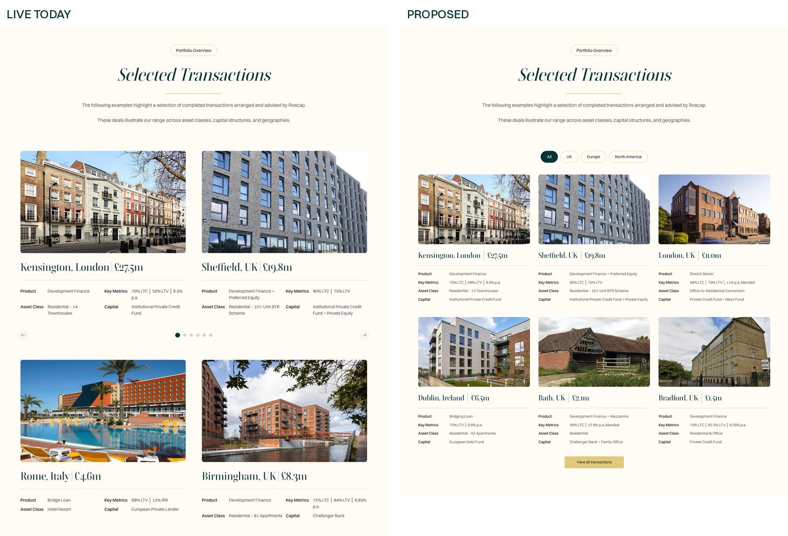
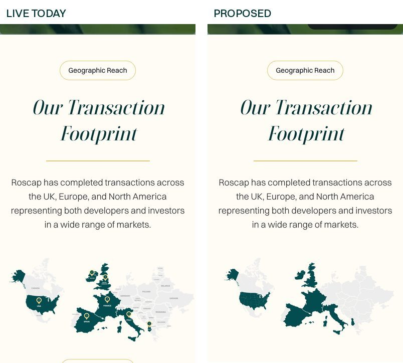
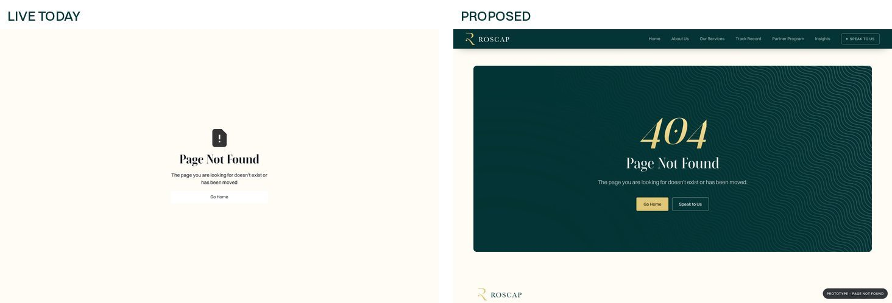
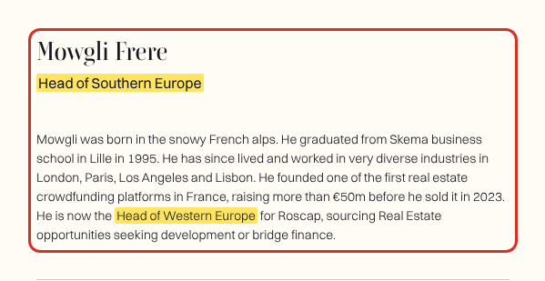
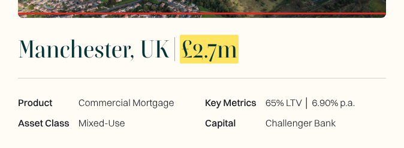
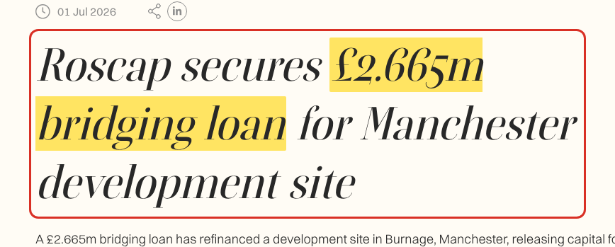
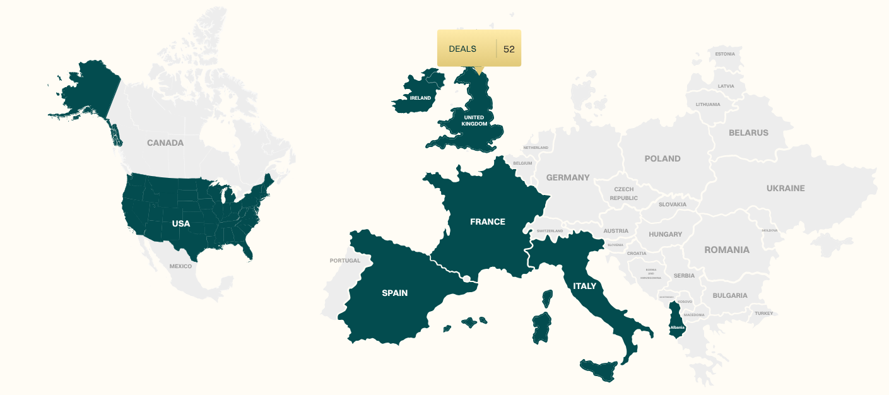
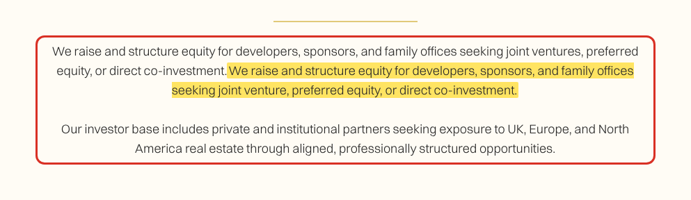

# Message for Clemente

Hi Clemente,

I've been through the whole website and prepared a new version of the main pages. Nothing is live yet: it goes on the staging site first, so you can check it before anything changes. The attached video shows today's site and the new version side by side, page by page, and there are a few screenshots below.

## What I've changed

- **Home:** the market rates panel now says "Held since the 18 Dec 2025 cut" instead of the misleading "Cut 25 bps"; the selected transactions list gets an "All transactions" row with all 22 deals; What We Do has more life in it.
- **Our Services:** the capital stack builds up as you scroll to it, and the repeated Equity sentence is fixed.
- **Track Record:** the map lights up country by country and now works on phones too; the deals become one grid you can filter by UK, Europe and North America, instead of the two sliders. The page also loads far faster: 12.8 MB today, under 1 MB in the new version.
- **Partner Program:** a clearer "How it works", moving partner logos, and a form that works on computers.
- **Speak to Us:** email, phone and WhatsApp (see question 4) under the heading, a shorter FAQ and form fixes.
- **Cookie banner**, which the law requires before Google Analytics can run.
- **Privacy Policy and Cookie Policy:** made more robust. They were missing a few things the law asks for, such as the registered office, the ICO registration number, how long data is kept and the list of cookies the site uses.
- **A proper "page not found" page** with our menu and footer, instead of Webflow's default.

## What I need from you

**1. Mowgli's title (About Us).** His card says "Head of Southern Europe", but the bio just below it says "He is now the Head of Western Europe for Roscap". Which one is right?
https://www.roscap.co.uk/about-us

**2. The Manchester deal.** The Track Record page shows Manchester as a £2.7m commercial mortgage (65% LTV, 6.90% p.a., challenger bank):
https://www.roscap.co.uk/track-record
The case study in Insights describes a £2.665m bridging loan in Burnage, Manchester, with Recognise Bank at 65% LTV over 12 months:
https://www.roscap.co.uk/blogs/roscap-bridging-loan-manchester
It looks like the same deal. Is it a bridging loan or a commercial mortgage, and should the card say £2.665m?

**3. The UK figure on the Track Record map.** Hovering over the UK shows "52 deals" (61 across all the countries, in line with the "60+ projects funded" on the homepage), while the list below shows 22 selected deals, 16 of them in the UK. Is 52 the right number for the UK?
https://www.roscap.co.uk/track-record

**4. WhatsApp.** On the Speak to Us page I'd like to add WhatsApp next to the email and phone number. Is +44 7850 522789 on WhatsApp?

## Things I found that weren't right

These are fixed in the new version; nothing needed from you.

- Our Services: the first sentence of the Equity paragraph appears twice.
- Partner Program: on a computer the Submit button does nothing, so nobody can sign up from a desk.
- About Us and Insights load a leftover test script from an outside website.
- The email links on four legal pages go nowhere.
- Google Analytics runs before visitors agree to cookies, which UK law doesn't allow.
- The market rates panel once showed the US rate as "400.00%" when its data source failed; I'm adding checks so a wrong figure can't show again.

Thanks,
Edu
